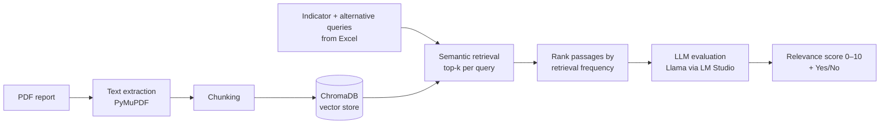

# Information Extraction from Sustainability Reports using LLMs

Extracting and scoring evidence for sustainability (ESG) indicators from long corporate reports, using Large Language Models and Retrieval-Augmented Generation (RAG).

Developed as my B.Sc. thesis in Computer Science at Harokopio University of Athens.

## The problem

Corporate sustainability reports often run to hundreds of pages. Checking whether a report addresses a specific sustainability indicator (for example emissions targets or energy efficiency) means reading the whole thing by hand.

LLMs can read and judge text, but a full report does not fit in a model's context window, and sending every page for every indicator is slow and expensive. This project explores two ways to solve that, and compares them.

## Two techniques

### Technique 1: Direct LLM extraction

The report is split into segments, and **every segment is sent to the LLM for every indicator**. The model returns the sentences that relate to that indicator.

- Simple and thorough: no part of the document is skipped
- Scales poorly: the number of LLM calls is *segments × indicators*
- Mitigated with asynchronous, batched requests (`asyncio` + `aiohttp`)

### Technique 2: Retrieval-Augmented Generation (RAG)

The report is indexed once in a vector database. For each indicator, only the **most relevant passages are retrieved** and sent to the LLM, which scores how well the report covers that indicator.

- One LLM call per indicator instead of one per segment
- Semantic search finds relevant text even when the wording differs
- Query expansion (several phrasings per indicator) improves recall



## How the RAG pipeline works

1. **Text extraction:** the PDF is parsed with PyMuPDF and cleaned of empty lines and extra whitespace.
2. **Chunking:** the text is split into fixed-size segments.
3. **Indexing:** segments are stored in a persistent ChromaDB collection, which embeds them automatically (default model: all-MiniLM-L6-v2).
4. **Retrieval with query expansion:** each indicator is searched by its name and by alternative phrasings. The top-k results of every query are collected.
5. **Ranking:** passages retrieved by several queries are ranked higher, and the best ones are combined into one context.
6. **LLM evaluation:** a locally hosted LLM acts as a judge, scoring the context's relevance to the indicator from 0 to 10, with a structured output that is easy to parse.

## Tech stack

| Area | Tools |
|---|---|
| Language | Python 3.13 |
| LLM | Llama, served locally through [LM Studio](https://lmstudio.ai/) (OpenAI-compatible API) |
| Vector database | ChromaDB |
| Document processing | PyMuPDF (fitz), NLTK |
| Data | pandas, Excel, JSON |
| Concurrency | asyncio, aiohttp |

Running the model locally means no document data leaves the machine and there are no API costs.

## Project structure

```
├── it22005_llm_1.a.py        # Technique 1: direct LLM extraction
├── it22005_llm_1.b.py        # Technique 1: second script (see config_1b.json)
├── it22005_llm_2.py          # Technique 2: RAG pipeline with ChromaDB
├── Alternative_queries.py    # Alternative queries used for query expansion
├── config_1a.json            # Configuration for technique 1 (a)
├── config_1b.json            # Configuration for technique 1 (b)
├── config_2.json             # Configuration for technique 2
├── indices.xlsx              # Sustainability indicators and their descriptions
├── indices.test.xlsx         # Test set of indicators
└── ArcerolMital_climateactionreport_1.pdf   # Sample report
```

## Getting started

### Requirements

- Python 3.13
- [LM Studio](https://lmstudio.ai/) with a Llama model loaded and the local server running

### Installation

```bash
git clone https://github.com/OrestisAnast/Information-extraction-LLM.git
cd Information-extraction-LLM
pip install pymupdf pandas openpyxl nltk aiohttp chromadb requests
```

### Configuration

Every run is controlled by a JSON config file, so models, files and parameters can change without touching the code. For example, `config_2.json` for the RAG pipeline:

```json
{
  "pdf_path": "ArcerolMital_climateactionreport_1.pdf",
  "excel_path": "indices.xlsx",
  "output_dir": "results",
  "llm_endpoint": "http://localhost:1234/v1/completions",
  "max_tokens": 50,
  "top_k": 20,
  "paragraph_limit": 20,
  "temperature": 0.2
}
```

| Parameter | Meaning |
|---|---|
| `max_tokens` | Size of each text segment |
| `top_k` | Passages retrieved per query |
| `paragraph_limit` | Passages passed to the LLM per indicator |
| `temperature` | LLM sampling temperature (lower = more consistent) |

### Running

Technique 1:

```bash
python it22005_llm_1.a.py
python it22005_llm_1.b.py
```

Technique 2 (RAG):

```bash
python it22005_llm_2.py
```

The RAG pipeline writes, for each indicator, the retrieved context (`<indicator>.txt`) and the LLM's score (`llm_score_<indicator>.txt`) to the output folder.


## Possible improvements

- **Chunk overlap or sentence-based chunking**, so passages are not cut mid-sentence
- **Hybrid search**, combining keyword search (BM25) with semantic search
- **A re-ranking model** to reorder retrieved passages before the LLM sees them
- **Systematic evaluation** with precision and recall against a labelled set of indicators
- **Agentic workflow** (e.g. LangGraph) that decides when to search again or ask for more context

## Author

**Orestis Anastasopoulos** · [GitHub](https://github.com/OrestisAnast) · [LinkedIn](https://www.linkedin.com/in/orestis-anast-028669336/)
